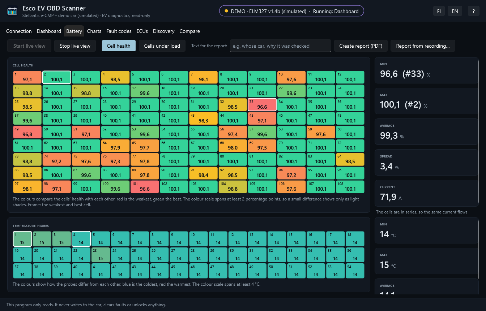
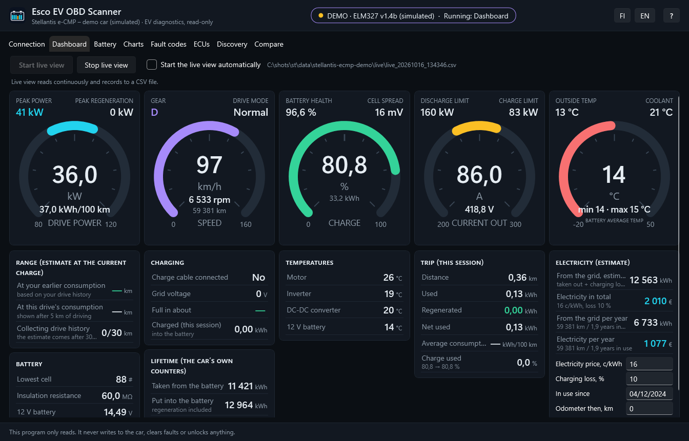
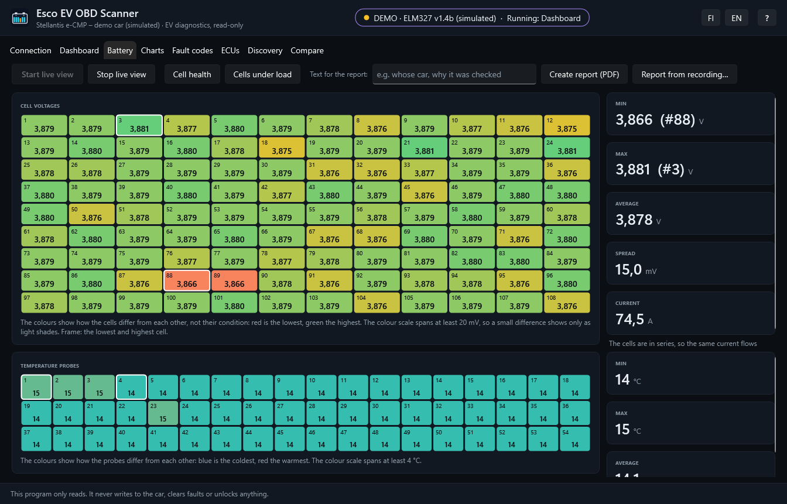
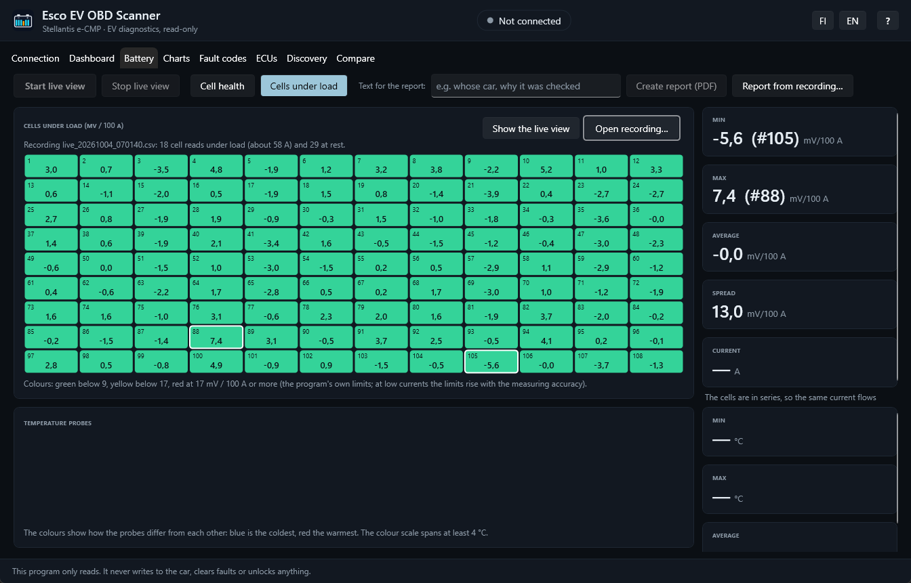

# Esco EV OBD Scanner

<picture>
  <source media="(prefers-color-scheme: dark)" srcset="assets/logo-dark.svg">
  
</picture>

Read-only diagnostics for electric cars over a serial ELM327 or STN adapter,
made first of all for the Stellantis e-CMP platform (Opel Mokka-e and
Corsa-e, Peugeot e-208 and e-2008, Citroën e-C4, DS 3 E-Tense): a Windows
app with a live dashboard, battery cell view and charts, and a
command-line scanner for working out what undocumented identifiers mean.

> **Just want to use it?** Download the MSI from [Releases](https://github.com/EsaHub/EscoEvObdScanner/releases),
> install it and press **?** in the app for the user guide (Finnish and English). You need an
> ELM327 or STN adapter (for example OBDLink EX or LX) that shows up as a COM port. Windows may warn "Windows protected your PC" because the
> installer is not signed with a paid certificate: choose **More info → Run anyway**.
> The rest of this page is for developers and the curious.



The program knows no car itself. Everything car-specific - ECU addresses,
identifiers, formulas, where the dashboard reads each value, how many cells the
battery has - comes from a car file in the `cars` folder, and the app lets you
pick the car. `cars/stellantis-ecmp.json` covers the
Stellantis e-CMP platform (Opel Mokka-e/Corsa-e, Peugeot e-208/e-2008, Citroën
e-C4, DS 3 E-Tense), tested on a 2023 Mokka-e and a 2023 Citroën e-C4. It is the main car
file: seven of its ECUs have been scanned through every identifier on the Mokka-e, and about 150
identifiers have been worked out or checked on the author's own drives, charges and
snaps, cell health included.
The Kia files are smaller and rest mostly on what other projects have published.
`cars/kia-niro-ev-2022.json` covers the second-generation Kia Niro EV (2022 on,
96 cells) from replies other people captured on US cars (OBDb), tested on a 2024
EU Niro EV. `cars/kia-eniro.json` covers the Kia e-Niro and Hyundai Kona Electric
2018–2022 from the positions evDash publishes, checked against its sample replies
but not tested on a car. Another make needs a new car file, not new code: see
[Adding a car](#adding-a-car).

> **Status:** early. Developed and tested with an OBDLink EX USB adapter
> (STN chip; it answers `ATI` as "ELM327 v1.4b") on a 2023 Opel Mokka-e and a 2024 Kia
> Niro EV, so that adapter is known to work. The identifier scans of the Mokka-e have also
> been run over Bluetooth with an OBDLink LX (classic Bluetooth, same chip family), as fast
> as over USB.
>
> On Windows 11 a Bluetooth OBD adapter does not show up in *Add device* until
> *Settings → Bluetooth & devices → Devices → Bluetooth devices discovery* is set to
> **Advanced**. Pairing creates two COM ports; use the outgoing one.
> The adapter must appear as a COM port: USB or classic Bluetooth, not Wi-Fi or
> Bluetooth LE. It must also handle long multi-frame replies and the flow control
> commands `ATFCSH`, `ATFCSD` and `ATFCSM`: the cell voltages come that way (on the
> e-CMP all 108 cells in one 243-byte reply). Without them the charge and voltages show
> but the cells do not, so the Battery tab is the test of a new adapter.
>
> Suomenkielinen käyttöohje: [OHJE.md](OHJE.md)

## What is in the box

| Project | What it is |
|---|---|
| `EscoEvObdScanner.App` | Windows app (WPF), the windows and drawing around `AppLogic`: vehicles (each car by a name of its own, with its own results), connection, dashboard (optionally started as soon as the adapter is connected; grouped values, a range estimate from your own drives on the charge gauge where the car gives the remaining energy; trip and charging energy and the session's peaks; lifetime energy counters with an electricity cost estimate at your price, the per-year figures counted from the date the car was taken into use and its odometer then), battery (every cell and temperature probe, cell health, cells under load), a battery report (PDF), charts, fault codes, ECUs (the car file's ECUs and their known and discovered identifiers, with their values read and the ECUs checked on request), discovery (finding ECUs, then scanning one for identifiers; both say what the car file lists as searched or scanned already), snapshot comparison; while the live view holds the adapter, the status bar says so on the tabs that read the car. Finnish and English. |
| `EscoEvObdScanner` | Command-line tool for reading, scanning, snaps, fault codes and ECU discovery (no dashboard, charts or report), for scripting and long scans; built from source, not in the MSI |
| `EscoEvObdScanner` → `cars/` | The car files |
| `EscoEvObdScanner.AppLogic` | What the app does, without Windows UI types: the view models of the tabs, vehicles, drive history, settings, the adapter session, the battery report (PDF) and the UI texts. The platform plugs in through `IAppHost` (dialogs, opening files, ports, a UI timer); the report font is read from the Windows font folder |
| `EscoEvObdScanner.Core` | Car diagnostics, used by the app and the command line: ELM327 transport, UDS parsing, car files, live values, analyses and ratings, fault codes, recordings, simulated car |
| `EscoEvObdScanner.Tests` | Unit and end-to-end tests against a simulated car built from real replies |
| `EscoEvObdScanner.Installer` | MSI installer (WiX) |

**No adapter?** The e-CMP car file also gives a demo car: a simulated
Mokka-e built from real, anonymised readings and fault codes stored in the program. In the app it is a car of its own
in the car list ("Stellantis e-CMP – demo car (simulated)"), and **Connect** then needs no
adapter; on the command line it is the port `demo`. It answers with a placeholder VIN
(VR7DEM…) so the report's VIN line can be seen, though a real e-CMP car does not give its VIN
over the OBD port. Its results go to a folder
of their own (`<car>-demo`), never among the real car's.

**Vehicles.** Each car you measure is a vehicle with a name of your own (a
registration number, "work car"), added on the Connection tab with its
car file. A vehicle has its own results folder (`Documents\EscoEvObdScanner\<vehicle>`)
and its own drive history for the range estimate; vehicles on the same platform
share the car file, so findings in one help them all. At the first connection the
app keeps a hash of an ECU serial number or the VIN (not the value itself; the
battery ECU first) and warns when the adapter is later on another car than the
vehicle chosen; when it surely is the same car (a replaced battery ECU), Yes in
the warning updates the hash. A car that gives neither is not checked, and the log says so. When no ECU of
the car file answers at all, the app warns that the vehicle probably has the wrong car file, or the car is off.
The VIN, where the car gives one, is kept with the vehicle for its reports.

## Safety

The program only sends read-only requests:

| Service | Purpose |
|---|---|
| 0x22 ReadDataByIdentifier | values |
| 0x24 ReadScalingDataByIdentifier | how a value is encoded, if the ECU says |
| 0x19 ReadDTCInformation | stored fault codes |
| 0x3E TesterPresent | ECU discovery (with a 0x22 read of F186 as fallback) |

Nothing that writes, clears or unlocks (0x10, 0x11, 0x14, 0x27, 0x2E, 0x2F,
0x31, 0x34-0x37, 0x85) exists anywhere in the code, and a test checks that
every request the scanner can produce is one of the four above.

Even so:

- Long sessions keep the car awake and drain the 12 V battery. Keep the car in
  READY or on charge.
- Some e-208 and Corsa-e owners report that an OBD adapter in use while driving
  upset the infotainment or the displays. If the car's screens behave oddly
  during the live view, stop it and unplug the adapter.
- ECU discovery puts a probe on the bus under every ID in the range. It skips
  the broadcast ID 0x7DF and the standard reply IDs 0x7E8-0x7EF and refuses
  anything below the car file's `probe_from` (0x600 if it does not say), where
  some IDs are ordinary messages and a probe can leave a stored fault code.
  The app's link test on the ECUs tab probes catalogued addresses below that (on e-CMP,
  the charger at 0x590 and the AVAS at 0x5B0) one by one, never by sweeping.
- Result files and logs can contain serial numbers. `.gitignore` keeps them
  out of the repository.

## Using the app







The **?** button at the top right opens the user guide (`EscoEvObdScanner.App/Help`, Finnish and English), which is also in the Start menu: the app's use, the report and its limits with their sources, and troubleshooting, for those who only install the MSI.

Install the MSI (or run `EscoEvObdScanner.App.exe` from `publish\app`, next to its `cars` and `help` folders), plug in the adapter, choose
the car and the port on the **Connection** tab and press **Connect**. Results (scans,
snapshots, fault codes, live CSV recordings, logs) go to
`Documents\EscoEvObdScanner\<vehicle>`, one subfolder per kind (the command line
uses the car file's name, `<car>`); earlier fault code reads
can be opened again from the Fault codes tab, which shows each code’s failure type and status bits by
their names in the standards (SAE J2012-DA, ISO 14229-1), untranslated, so they can be looked up. **Create report (PDF)** on the
Battery tab writes a battery report of what the app shows: the values, every
cell and probe, and the fault codes if they were read, with rough ratings
(health, cell spread at rest, cells under load, temperature spread, insulation, battery ECU faults).
With the live view running during a drive it adds the drive (its time span, distance, energy,
consumption, highest load) and the cells that sag most under load beyond their
offset at rest (internal resistance, not charge), next to their health; **Report from recording…** makes the same report afterwards from a saved
live view, picked from a list that shows each one's time, distance and cell reads.
The report starts with the car's VIN, so it can be compared with the windscreen and
the registration document: read at the connection and kept with the vehicle, so a
report made later has it too. Not every car gives it (the e-CMP does not over the OBD
port); then it can be written in the **Text for the report** field. Where the car gives them,
the report lists the battery management's date of manufacture, the battery's age and wear rate
((100 % − SOH) per year and per 10,000 km, assuming the new battery was at 100 %) and its software
and hardware versions (the e-CMP; read at the connection and kept with the vehicle like the VIN, so a report made from a recording has them too, with the date they were read), the 12 V battery's voltage with a note on reading it at rest
(Battery University BU-903 [6]), and the car's lifetime counters: energy into and out of the battery (the Niro EV and the e-CMP),
AC and DC charging sessions and energy (the Niro EV), starts and time above 55 °C (the e-CMP). A Source column in each table says
whether a figure is given by the car or calculated. The report ends with how each
calculated figure is calculated, the limits of every rating with their basis (see
below), and where each figure comes from. In Finnish, dates and numbers are in Finnish format; in English, in the
Windows regional format.
Working copies of the car files live in `%LOCALAPPDATA%\EscoEvObdScanner\cars`, so
scan results can be merged into them without write access to Program Files. A
car file from elsewhere can be imported on the Connection tab. The command line
works on the car files in a `cars` folder in the current folder or next to its
exe instead, so a merge on the command line does not reach the app's copies.

## Ratings and their basis

The report rates a few figures as Good, Attention or Check. The limits are in
`BatteryChecks`, and the report lists them with their basis. Where a source
exists it is named; where none does, the limit is the program's own and says so.
They are offered for others to judge and improve:

| Rating | Good | Attention | Check | Basis |
|---|---|---|---|---|
| Battery health (SOH) | 90 % or more | 80–90 % | below 80 % | The program's own limits. For comparison, battery warranties: Kia guarantees 70 % for 7 years or 150,000 km [1]; Stellantis about 70 % for 8 years or 160,000 km [2]. |
| Cell spread at rest | below 30 mV | 30–80 mV | 80 mV or more | A healthy pack's cells are within 10–20 mV, and 50–100 mV is a red flag depending on the manufacturer [3]; the limits sit between the two and in the red-flag range. Rated only at 5 A or less, as current spreads the cells. |
| Cells under load | below 5 mV / 100 A | 5–15 | 15 or more | The program's own limits; there is no published source. The principle: a cell's internal resistance grows as it ages and shows as a voltage sag under load. The limits rise to the measuring accuracy, scaled to 100 A: 5 mV at base (in test drives the same cells varied by up to about 4 mV from drive to drive), or half the car's step where cell voltages come in coarse steps (20 mV on the Kia, so 10 mV). When the coldest probe is below 10 °C under load, the rating is at most Attention: in the cold the cells’ resistance rises, most in the coldest parts of the pack. |
| Temperature spread | below 5 °C | 5–10 °C | 10 °C or more | Battery thermal management aims at a spread below 5 °C between cells [4]; the Check limit is the program's own. A large spread can point at cooling or a probe. |
| Insulation | 500 kΩ or more | 500 Ω/V of the pack voltage – 500 kΩ | below 500 Ω/V of the pack voltage | UNECE R100 [5]: at least 500 Ω per volt of the working voltage where the battery's DC side and the motor's AC side are connected (100 Ω/V for separate or doubly insulated buses; the stricter one is used). For a 400 V battery that is 200 kΩ. The Good limit is the program's own; over 1000 V, where the legal limit is higher, Good starts at the legal limit. |
| Battery ECU faults | none | past, not now | active | An active fault is on now, a past one has been, not now. Only the battery ECUs' codes count. |

Other figures in the report are measured, not judged: "a typical cell differs
by about 2 mV" is the median of this drive's cells, and every calculated figure
has its formula in the report's "How the figures are calculated" section.

1. [Kia: battery warranty](https://www.kia.com/sk/predajca/aspekta/o-nas/zazitok-kia/zodpovednost/electrification/)
2. [Carwow: Peugeot e-208 maintenance and battery warranty](https://www.carwow.es/blog/mantenimiento-peugeot-e-208)
3. [Midtronics: Early Signs of Cell Imbalance in High Voltage EV Batteries (2025)](https://www.midtronics.com/blog/early-signs-of-cell-imbalance-in-high-voltage-ev-batteries/)
4. [Battery Thermal Management Systems for EVs and Its Applications (SciTePress 2022)](https://www.scitepress.org/Papers/2022/110307/110307.pdf)
5. [UNECE Regulation No 100, paragraph 5.1.3](https://www.lexaris.de/library/tableofcontents/2059009)
6. [Battery University: BU-903 How to Measure State-of-charge](https://batteryuniversity.com/article/bu-903-how-to-measure-state-of-charge) (the 12 V battery's rest voltage)

## Using the command line

```
EscoEvObdScanner <COMx> known                    read every catalogued DID once - start here
EscoEvObdScanner <COMx> ecus [fromId toId]       find responding ECUs
EscoEvObdScanner -      blocks                   show the scan plan
EscoEvObdScanner <COMx> scan <blockId> [ecuId]   sweep a catalogued range
EscoEvObdScanner <COMx> scan <from> <to> <ecuId> sweep any range
EscoEvObdScanner <COMx> watch <ecuId> <did,...> [ms]   print values as they change
EscoEvObdScanner <COMx> watch <ecuId>:<did,...> [<ecuId>:<did,...> ...] [ms]   the same over several ECUs in turn
EscoEvObdScanner <COMx> dtc [ecuId] [--deep] [--all-ecus]   read stored fault codes
EscoEvObdScanner <COMx> scaling [ecuId]          ask ECUs how values are encoded
EscoEvObdScanner <COMx> snap [ecuId] [--note "text"] [--rare] [--refused] [--all]   read what was found so far, once
EscoEvObdScanner -      diff <snapA> <snapB>     what changed between two snaps
EscoEvObdScanner -      merge <run.jsonl> ...    fold scan results into the car file

EscoEvObdScanner -      cars                     list the car files

Options:  --car <name>   --catalog <path>   --out <folder>   --baud <rate>   --trace
Port "demo" runs against the simulated car; its results go to <car>-demo.
```

With several car files (three are shipped), add `--car <name>` to every command,
e.g. `EscoEvObdScanner COM4 known --car stellantis-ecmp`.

`scan` exits with 2 when it stopped early (the ECU went silent or answered only
errors, refused the service, or the adapter could not address it) and with 0 when
it is done. The value options `--car`, `--catalog`, `--out`, `--baud` and `--note`
are an error without a value: the command stops with a message instead of ignoring them.
Output sent to a file or a pipe is UTF-8 (°, ä, Ω); in Windows PowerShell 5.1 set
`[Console]::OutputEncoding = [Text.Encoding]::UTF8` first, or it reads the bytes in the old code page.

A typical session:

1. `known`: a readable ECU serial number and software version prove the whole chain works.
2. `scan d8xx bms`: the densest block first.
3. `merge scan_*.jsonl`: new identifiers land in the car file's `discovered` array.
4. `snap` before and after a change (charging, a drive, the heater), then `diff`:
   what moved, and by how much, tells what an identifier means.
5. Move identifiers you have worked out from `discovered` to `dids`, with an expression.

## Building

Requires the .NET 10 SDK.

```powershell
dotnet build EscoEvObdScanner.slnx
dotnet test --project EscoEvObdScanner.Tests          # unit + simulated-car tests
.\EscoEvObdScanner.App\bin\Debug\net10.0-windows\EscoEvObdScanner.App.exe --selftest out   # UI self-test, screenshots in out\
.\build-installer.ps1                               # self-contained exe + MSI in publish\ (version from Directory.Build.props)
```

`--selftest <folder>` drives the real UI against the demo car (connect, live
view, every tab and action), saves a screenshot of each tab and writes
`report.txt`. The screenshots in `assets/screenshots` are its `03_battery_health_en.png`,
`03_battery_en.png` and `02_dashboard_live_en.png`, made in a folder whose path holds no user name;
`cells-under-load.png` is the Battery tab's **Cells under load** view with a real drive of the author's car opened from **Open recording…**. It uses its own folders, never the user's results or settings.

## Car files

A car file (`EscoEvObdScanner/cars/<name>.json`) holds everything the code does
not hard-wire. With one car file the command line uses it; with several, choose
with `--car <name>`.

- `version`: goes up with every change of a shipped car file (see below).
- `platform`: name, the cars it covers, the ELM327 protocol (`elm_protocol`, the `ATSP` code), the lowest ID ECU discovery
  may probe, the address range most ECUs live in (the app's default ECU search range), identifiers
  that identify one car, where freeze frames keep the time and odometer, gauge
  ranges, and `demo` where the built-in demo car stands in for it.
- `live`: where the dashboard reads each value.
- `ecus`: the ECUs and, under each, the identifiers that have been worked out
  (`dids`) and the ones found by scans whose meaning is still open (`discovered`).
- `blocks`: the scan plan, run in `order` (0 first).
- `ecu_search`: the address ranges the ECU search has covered, with dates and results in `notes` where known.

```json
"ecus": [
  { "id": "bms", "name": { "fi": "Akunhallinta (BMS)", "en": "Battery management (BMS)" },
    "request": "0x6B4", "response": "0x694",
    "dids":       [ { "did": "0xD410", "name": { "fi": "Varaustila, kalibroitu", "en": "State of charge, calibrated" },
                      "unit": "%", "expression": "(B4*256+B5)/512", "confidence": "confirmed", ... } ],
    "discovered": [ { "did": "0xD802", "confidence": "unknown", "source": ["own-scan"], "bytes": 4, "samples": [ ... ] } ] }
]
```

Every entry says how sure it is (`confidence`) and why (`source`, `notes`). `source` is a list of ids
from the file's `sources` (`own-scan`, `own-snaps` and `own-watch` are this program's own
measurements); the dates and details are in `notes`. `bytes` is the reply length. A field
without a value is left out rather than written as `null`. Within an ECU the entries
are sorted by confidence (confirmed first), then by identifier.
`merge` adds scan results to the right ECU's `discovered` list.

What a read leaves out by default:

- An identifier with `"changes": "rarely"` holds a value that seldom changes (versions,
  supplier details, configuration). Snaps and the ECUs tab read it only when asked
  (`snap --rare`, the "rarely changing" option). `merge` drops the mark when a new value arrives.
- An identifier whose `kind` is a refusal (`negative:conditionsNotCorrect`, for example) exists
  but the ECU would not give its value when scanned. Read only when asked (`snap --refused`,
  the "refused" option); a later positive reply merged in turns its `kind` to `positive`.
- An ECU with `"answered": false` has not answered this car (an address from a public list).
  Fault code reads skip it unless asked (`dtc --all-ecus`); the ECUs tab lists it last, not selected.

An ECU the ECU search added to a working copy carries `"found_by_search": true`; when a newer
shipped file arrives, such an ECU is kept with the user's findings, while one the shipped file
no longer lists is left out.

Each ECU's `scanned` lists the identifier ranges scanned on it, as `{ "range": "0xD000-0xDFFF",
"notes": "date and result" }`; `"step": 16` marks a range where only every 16th identifier was read.
The scan tab and the command line's `scan` show what of the chosen range is scanned already.

ECUs, blocks and identifiers are named per language in `name` (`"fi"`, `"en"`,
or any other language code); a test requires Finnish and English for every
name. The app shows the UI language, else English; the command line and saved
files use English. An identifier is known by its ECU and `did`, not by its
name. A plain string as `name` counts as English.

The app works on a copy of each car file in `%LOCALAPPDATA%\EscoEvObdScanner\cars`,
since scan results are merged into it. When a newer version of a shipped car
file is installed (a higher `version`), a copy without merged results is
replaced; one with merged results becomes the new file with those results
carried over; either way the copy is kept in `cars\backup` first. A copy that
does not load as a car file is replaced by the shipped one the same way (kept as
`<name>-broken-<time>.json`), and the log says so. A car file imported on the
Connection tab is never replaced by an update.

## Adding a car

Copy a car file, set its `version` to 1 (raise it with every later change), give it the new make's ECUs and identifiers, and fill in
`live` as far as the identifiers are known; anything left out stays empty on
the dashboard. A value is read from one identifier and decoded with the
entry's own `expression`, else the identifier's expression in the car file, else as
the whole reply read as one unsigned number. Several values may come from the
same identifier; it is read once per round.

```json
"live": {
  "soc":   { "ecu": "bms", "did": "0x0101", "poll": "fast", "expression": "B10/2", "min": 0, "max": 100 },
  "cells": { "ecu": "bms", "dids": ["0x0102", "0x0103"], "poll": "cells",
             "bytes": 1, "skip": 2, "scale": 0.02, "min": 2, "max": 4.5, "columns": 16 },
  "gear":  { "ecu": "vcu", "did": "0x0104", "poll": "slow", "map": { "0": "P", "1": "R", "2": "N", "3": "D" } }
}
```

The value names (`soc`, `temp_min`, `cells` ...) are the same for every car:
the app reads only these names, and each car file says where its car keeps the
value. A test requires every `live` name to be one the app knows. Where each
car file reads them (`-`: not known for that car):

| Value | Stellantis e-CMP | Kia Niro EV (2022–) | Kia e-Niro / Hyundai Kona Electric (2018–2022) |
|---|---|---|---|
| `soc` | BMS D410 | BMS 0105 `B35/2` | BMS 0105 `B35/2` |
| `soc_raw` | BMS D810 | BMS 0101 `B8/2` | - |
| `voltage` | BMS D815 | BMS 0101 `[B16:B17]/10` | BMS 0101 `[B16:B17]/10` |
| `current` | BMS D816 | BMS 0101 `S[B14:B15]/10` | BMS 0101 `S[B14:B15]/10` |
| `energy` | BMS D865 | - (0105 `[B32:B33]*2/1000` is a candidate; its meaning is open) | - |
| `soh` | BMS D860 | BMS 0105 `[B29:B30]/10` | BMS 0105 `[B29:B30]/10` |
| `aux_voltage` | BMS D822 | BMS 0101 `B33/10` | BMS 0101 `B33/10` |
| `temp_min` | BMS D87D | BMS 0101 `SB19` | BMS 0101 `SB19` |
| `temp_avg` | BMS D877 | - | - |
| `temp_max` | BMS D817 | BMS 0101 `SB18` | BMS 0101 `SB18` |
| `temp_delta` | BMS D878 | - | - |
| `max_charge_power` | BMS D871 `500-[B4:B7]/128` | BMS 0105 `[B20:B21]/100` | - |
| `max_discharge_power` | BMS D873 `[B4:B7]/128-500` | BMS 0105 `[B22:B23]/100` | - |
| `isolation_pos` | BMS D87B | BMS 0101 `[B61:B62]` | - |
| `isolation_neg` | BMS D87C | - | - |
| `cell_min` | BMS D86F | BMS 0101 `B29/50` | BMS 0101 `B29/50` |
| `cell_max` | BMS D870 | BMS 0101 `B27/50` | BMS 0101 `B27/50` |
| `lowest_cell` | BMS D43C | BMS 0101 `B30` | BMS 0101 `B30` |
| `cells` | BMS D440 | BMS 0102, 0103, 0104 | BMS 0102, 0103, 0104, 0105 |
| `probes` | BMS D442 | BMS 0101, 0105 | BMS 0101 |
| `cell_soh` | BMS D4B5 | - | - |
| `speed` | VCU D402 | AIRCON 0100 `B33` | ABS C101 `B10` |
| `motor_rpm` | VCU D8CF | BMS 0101 `S[B57:B58]` | BMS 0101 `S[B57:B58]` |
| `ambient` | VCU D434 | AIRCON 0100 `B10/2-40` | AIRCON 0100 `B10/2-40` |
| `odometer` | VCU D49C | CLUSTER B002 `[B10:B12]` | CLUSTER B002 `[B10:B12]` |
| `gear` | VCU D4E7 | VCU E004 `B18` | ABS C101 `B12` |
| `drive_mode` | VCU D819 | - | - |
| `charging` | OBC D854 | - | - |
| `grid_voltage` | OBC D82B | - | - |
| `motor_temp`, `dcdc_temp` | VCU D8CD, D8CE | - | - |
| `inverter_temp` | MCU DC6A | - | - |
| `coolant_temp`, `aux_battery_temp` | VCU D8F9, D496 | - | - |
| `battery_made`, `bms_software`, `bms_hardware` | BMS F18B, F195, F193 | - | - |
| `contactor_closes`, `time_above_55c` | BMS D416, E082 | - | - |
| `lifetime_charged_kwh` | BMS D42E `[B4:B7]/16` | BMS 0101 `[B42:B45]/10` | - |
| `lifetime_discharged_kwh` | BMS D42E `[B8:B11]/16` | BMS 0101 `[B46:B49]/10` | - |
| `ac_charges`, `dc_charges` | - | BMS 0111 `[B8:B11]`, `[B12:B15]` | - |
| `ac_charged_kwh`, `dc_charged_kwh` | - | BMS 0111 `[B16:B19]`, `[B20:B23]` | - |

| Field | Meaning |
|---|---|
| `poll` | how often the value is read: `fast` every round (about a second), `slow` every 5th (the default), `cells` every 10th, `rare` every 60th; the `cells` value is also read in between, at most every 5 s, while the battery current is 40 A or more |
| `min`, `max` | plausible range of the final value; anything outside is dropped |
| `scale`, `offset` | value × scale + offset (for arrays, applied to each raw element) |
| `dids`, `bytes`, `skip` | arrays: replies read in order, bytes per element, bytes skipped at the start of each reply |
| `count` | arrays: elements to take from each reply; the read fails if a reply holds fewer. Empty slots at the very end (all-zero or all-0xFF bytes outside `min`/`max`) are left out, so a smaller pack in the same layout shows its own cell count. It takes at least two such slots, and the same short read twice in a row; a single 0 V cell at the end shows as a dead cell, but two dead last cells cannot be told from a smaller pack. Without it the elements run to the end of the reply, or to the first one outside `min`/`max` |
| `signed` | elements are two's complement (temperatures below 0) |
| `parts` | arrays whose pieces differ: a list of `{ "did", "skip", "count" }`, read in order, instead of `dids` |
| `columns` | arrays: elements per row in the battery view |
| `map` | code to text, for gear and drive mode |
| `on` | yes/no values only (`charging`; ignored on any other value): the codes that mean yes; without it any value above 0 is yes |
| `format` | `battery_made`: the byte order of the BCD date, `dmy` (the default) or `ymd` |

Value names: `soc`, `soc_raw`, `voltage`, `current` (positive = discharge),
`energy`, `soh`, `aux_voltage`, `temp_min`, `temp_avg`, `temp_max`,
`temp_delta`, `max_charge_power`, `max_discharge_power`, `isolation_pos`,
`isolation_neg`, `cell_min`, `cell_max` (V), `lowest_cell`, `speed`,
`motor_rpm`, `ambient`, `odometer`, `gear`, `drive_mode`, `charging` (charge cable
connected: above 0, or the codes in `on`), `grid_voltage`, the drivetrain temperatures `motor_temp`, `inverter_temp`,
`charger_temp`, `dcdc_temp`, `coolant_temp` and `aux_battery_temp` (°C; a dashboard group of
their own, shown when the car file gives any of them), the lifetime counters `lifetime_charged_kwh`,
`lifetime_discharged_kwh` (kWh into and out of the battery), `ac_charges`,
`dc_charges`, `ac_charged_kwh`, `dc_charged_kwh`, `contactor_closes` and `time_above_55c` (shown in the report
when the car file gives any of them), the texts `battery_made` (a BCD date, day month year unless `format` says otherwise),
`bms_software` and `bms_hardware` (ASCII; shown in the report), and the arrays `cells` (V), `probes` (°C) and
`cell_soh` (%). The cell count is simply how many values the replies hold.

In `platform`, `warranty` (`{ "fi": …, "en": … }`) is the maker's battery warranty with its
source, shown next to the report's SOH limit, and `demo_drive` tells the built-in demo car
how to move: `rpm_per_kmh` (motor speed per km/h) and `ignore_tester_present` (ECU ids
that do not answer TesterPresent, as on the real car). The demo car moves the values the
`live` section names (`speed`, `motor_rpm`, `current`, `soc`, `voltage`, `cells`),
encoded with their own expressions.

## Expressions

The `expression` field of a DID turns response bytes into a value. Bytes are
numbered from the start of the response including the length byte, so the
payload starts at `B4`:

```
B0 = length   B1 = 0x62   B2..B3 = DID   B4.. = payload
```

| Syntax | Meaning |
|---|---|
| `B4` | one byte, unsigned |
| `[B4:B5]` | bytes 4-5, big-endian, unsigned |
| `SB4`, `S[B4:B5]` | the same, two's complement signed |
| `+ - * / ( )` | arithmetic |

Examples: `(B4*256+B5)/512`, `[B4:B5]/16`, `[B4:B7]/64-1200`.

## Findings

What this tool found on a 2023 Mokka-e that the public sources listed under
[Credits](#credits) did not document. "Confirmed" means checked on the car
against the dashboard, a charge, a drive or another known value; "likely" means
the readings fit but have not been checked that way. Each identifier's
`confidence` and `notes` in the car file give the evidence and raw samples.

**ECUs.** Three more ECUs answer diagnostic requests on the OBD port: 0x6AD
(ABS/ESP), 0x6B5 (power steering) and 0x74A (windscreen camera for driver assistance, on a separate reply
offset of -0x100). A fourth, 0x6A6, is the motor control unit (MCU_ECMP); the
wican e-208 profile already reads the odometer from it.

**Confirmed**

| ECU | DID | Meaning |
|---|---|---|
| VCU 0x6A2 | D8F0, D8F1 | pack maximum and minimum temperature |
| VCU 0x6A2 | D819 | drive mode: 2 Sport, 6 Normal, 7 Eco |
| VCU 0x6A2 | D4E7 (copies D85D, D8C2) | gear selector: 0 P, 1 R, 2 N, 3 D |
| VCU 0x6A2 | D8E6 | HV bus voltage in whole volts (the pack voltage in Ready, about 12 V with the contactors open) |
| VCU 0x6A2 | D414 | outside temperature, the same as D434 |
| VCU 0x6A2 | D403, D463, D4B7, D85B | brake pedal: 1 pressed, 0 released |
| VCU 0x6A2 | D4C0 | Ready: 3 in Ready, 0 otherwise |
| VCU 0x6A2 | D818 | power state: 3 Ready, 4 HV on but not Ready (also while charging), 0 contactors open |
| VCU, charger | D8AA | charging state: 0 charge session (charging or waiting), 2 charge finished with the cable in, 3 no cable |
| BMS 0x6B4 | D433, D434 | HV bus voltage after the contactors, /16 V (the pack voltage when they are closed) |
| BMS 0x6B4 | D449 | a further pack current (reading 3 in the car file), the same scale and sign as D816 (within 0.02 A at a steady current) |
| BMS 0x6B4 | D49C | odometer, km/1024 (OBDb's /1000 does not match the dashboard) |
| BMS 0x6B4 | D42E | lifetime energy counters, 1/16 kWh: energy into the battery, regeneration included (a DC charge added 23.06 kWh against 23.68 kWh on the charger), and out of it (20.1 kWh/100 km over 341 km against 19.5 on the trip computer); the third word is the odometer + 9 km. The energy into the battery reads 0 after the car wakes until it has driven or charged; the app then leaves it out |
| BMS 0x6B4 | D47D | BMS clock, seconds |
| MCU 0x6A6 | DC06, DC37 | HV voltage at the motor control unit, /32 V (two measuring points) |
| Charger 0x590 | D824 | HV voltage at the charger |
| Charger 0x590 | E119, E11B | HV voltage at the charger, /128 V (two measuring points within 0.5 V of the pack voltage) |
| Charger 0x590 | D822 | 12 V system voltage |
| Charger 0x590 | D80C | 12 V system voltage, a second reading 0.3 V below D822 |
| Charger 0x590 | D855 | the same as the charge cable value D854: 100 with the cable in, 0 unplugged |
| VCU, charger | D8EB | state of charge, /10 % (equals BMS D410 and the dashboard %) |
| VCU, charger | D4CA | vehicle clock in 0.1 s steps, which dates the fault code freeze frames (name from Battery-Emulator, scale found here; the BMS and the motor control unit hold the same clock) |
| VCU, BMS, charger | D866 | Ready: 8 in Ready, 0 when off or on but not Ready (on the VCU and the charger also D4B9: 1 / 0) |
| Power steering 0x6B5 | D419 | lane keeping assist: 2 on, 1 off |
| Power steering 0x6B5 | D41B | lane keeping active: 2 active, 0 off or not active |

Identifiers the public sources name, checked here on the car: the pack SOH
(BMS D860) is exactly the lowest of the per-cell health values (D4B5), so the
pack is rated by its weakest cell; the lowest and highest cell numbers (D43C, D43B)
point at the lowest and highest cell of the cell voltages, and the hottest and
coldest probe numbers (D445, D446) at those of the temperature probes (all four
zero-based, so +1); the sum of cell voltages (D438) matches the 108 cells added up,
and the average cell voltage (D43D) equals their mean; the pack maximum temperature
(D817) equals the minimum plus the spread and the hottest probe; the odometer (VCU
D49C; the motor control unit holds the same) matches the dashboard; the motor speed
(VCU D8CF and MCU DC00) keeps a fixed ratio to the road speed, 67.02 and 66.98 rpm
per km/h on the same drive; and the motor power (VCU D8D9) was 0.93 of the battery
power over a drive and 0.97 above 30 kW, the rest going to the auxiliary load. The
accelerator pedal (VCU D407) reads B4/2 %: raw 199 with the pedal fully down, 0 released. The
actual motor torque (VCU D8D0) reached 259 Nm on a drive (the Mokka-e is rated 260 Nm), and the
motor power D8D9 is 1.15 times torque × motor speed driving and 0.91 times it regenerating, as
electric power against shaft power. The raw SOC (BMS D810) stays within 0.4
points of the calibrated SOC D410. The BMS
power limits (D871-D874, named by evDash and Battery-Emulator) read `[B4:B7]/128-500` kW, OBDb's
scale: discharge for 10 and 30 s up to exactly 160 kW, charge and regeneration negative and
shrinking as the battery fills, the 30 s limit never larger than the 10 s one; drives stayed within
them (114 kW out, 68 kW regeneration).

**Likely: not checked or candidates** (the app's *not checked* and *candidate* levels)

| ECU | DID | Meaning |
|---|---|---|
| Charger 0x590 | D82B | AC grid voltage (229-235 V plugged in, 0 unplugged) |
| Charger 0x590 | D5CF, D5D1 | AC grid voltage, /100 V (two readings within 1.5 V of D82B; 0 unplugged) |
| Charger 0x590 | D829 | 12 V side current, about 1 A per step (follows the rear window heater, seat heater, lights and fan, but also rises with the cabin heating) |
| BMS 0x6B4 | D813, D44C, D44D, D452, D453 | HV contactors open (0) or closed; closed also after leaving Ready and with the charge cable in |
| BMS 0x6B4 | D413, D862, D863 | further SOC variants |
| BMS 0x6B4 | D416 | contactor close counter (name from Battery-Emulator; grows with each HV contactor closing, also at the end of a DC charge) |
| MCU 0x6A6 | DC71 | motor temperature, /100 °C (rises while driving, falls when parked) |
| VCU 0x6A2 | D880 | requested motor torque (name from OBDb), /10 Nm: tracks the actual torque D8D0 about 0.2 s ahead (peak 261 against 259 Nm); the data cannot tell requested from actual |

**Published by others, not checked yet** (the app's *not checked* level; on this car the published scale gives plausible values)

From OBDb's Peugeot signal set and Battery-Emulator: on the VCU the 12 V battery (D496), motor
stator (D8CD), DC-DC converter (D8CE), motor coolant inlet (D8D6) and
traction circuit coolant temperatures (D8F9), and the heating circuit coolant temperature (D8FB),
which on this car follows the cabin heater; on the MCU the inverter temperatures (DC04, DC6A); on
the BMS the insulation resistance (D47A). The ESP speed (VCU D802) reached 68.8 km/h on a
drive on 2026-10-09 but has not been compared with a known value yet. The on-board charger temperature (VCU D8E1) reads a fixed 29 °C whenever the
charger is idle and moves only around AC charging, so the app does not show it.

**Answering, meaning still open**

| ECU | Ranges | DIDs |
|---|---|---|
| VCU 0x6A2 | D4xx, D8xx | about 130 |
| VCU 0x6A2 | **D5xx, D6xx, D7xx**: groups not mentioned anywhere | 31 |
| VCU 0x6A2 | E031-E0A9 (E031-E03A: a log of the last ten charges, fields not worked out) | 16 |
| BMS 0x6B4 | D4xx, D8xx (many named by Battery-Emulator, without scale) | about 80 |
| BMS 0x6B4 | **DC0F, DC63-DC65, DF63-DF64**: groups not mentioned anywhere (D900 and E082 nearby are named by Battery-Emulator) | 6 |
| MCU 0x6A6 | D4xx, DCxx | about 20 |
| Charger 0x590 | D4xx, D8xx, F1xx | about 45 |
| Charger 0x590 | **D5BD, D5D0, D5D2**: the rest of a group not mentioned anywhere, with D5CF and D5D1 above (answers with and without the charge cable) | 3 |
| Charger 0x590 | E000-E707 | 131 |
| ABS/ESP 0x6AD | D4xx, D6xx | 77 |
| Power steering 0x6B5 | D4xx | 20 |
| Windscreen camera 0x74A | D4xx, D5xx | 18 |
| Windscreen camera 0x74A | FD00-FD79 (supplier area) | 70 |

Not found on the ECUs that answer: the VIN, the dashboard's range estimate, the
trip computers and the seat heaters. They seem to live
in ECUs that are not reachable from the OBD port (the BSI, the climate unit).

## Languages

The UI texts are in `EscoEvObdScanner.AppLogic/Localization`, one file per language
(`fi.json`, `en.json`) with the same keys. Another language is another file;
it shows up as a button next to FI and EN. A test checks that every language
has every text with the same placeholders. Car files name their ECUs, blocks
and identifiers per language in `name`; another language is another code
there, and a missing one shows in English.

## Contributing identifiers

Findings are welcome. Open an [issue](https://github.com/EsaHub/EscoEvObdScanner/issues/new/choose):
**New identifier or car** for a value you have worked out, a correction to a car file or a car
you would like supported, **Bug report** for something in the program. For each identifier,
include the car model and year, the raw response and what the car was doing at the time.
Remove the VIN and ECU serial numbers first: logs and result files contain them.

## Credits

The car files are a compilation of facts (addresses, identifiers, byte
positions, scales) from these sources, the further ones each car file lists under
`sources`, and own measurements; each identifier's `source` field says where it came from. No code, definitions or data files from
those projects are included; the test data and redistributed libraries that are
third-party are listed in [THIRD-PARTY-NOTICES.md](THIRD-PARTY-NOTICES.md).

- [meatpiHQ/wican-fw discussion #278](https://github.com/meatpiHQ/wican-fw/discussions/278)
- [evDash](https://github.com/nickn17/evDash) (MIT): its e-208 decoder independently confirms several identifiers found with this tool, its e-Niro decoder is the source of the Kia e-Niro car file, and its E-GMP decoder confirms the temperature layout of the Niro EV 2022 file
- [OBDb Kia-Niro-EV](https://github.com/OBDb/Kia-Niro-EV) (CC BY-SA 4.0): signal definitions and replies captured from US 2023-2026 Niro EVs, the main source of the Niro EV 2022 car file, and replies from 2019-2022 cars, checked against the cell deterioration fields of the e-Niro file
- [JejuSoul OBD-PIDs-for-HKMC-EVs](https://github.com/JejuSoul/OBD-PIDs-for-HKMC-EVs): PID lists for Hyundai and Kia EVs; the cell deterioration fields of the e-Niro file
- [OBDb Peugeot-208](https://github.com/OBDb/Peugeot-208): signal definitions that give names and scales for several VCU, motor control unit and BMS identifiers of the e-CMP file
- [OVMS v3](https://github.com/openvehicles/Open-Vehicle-Monitoring-System-3): its Hyundai Ioniq 5 (E-GMP) module, which the 2023 Niro EV follows (issue #912), for the gear selector and tyre layout
- [WiCAN vehicle profiles](https://github.com/meatpiHQ/wican-fw/tree/main/vehicle_profiles): the e-208 profile (odometer on the motor control unit) and the Ioniq 5/6 profile (power limits and the remaining energy candidate on the Niro EV 2022)
- [Battery-Emulator](https://github.com/dalathegreat/Battery-Emulator): names for many BMS identifiers from bench tests on e-CMP packs
- [opendbc](https://github.com/commaai/opendbc): the PSA AEE2010 diagnostic ID list that identified several ECUs
- [PyPSADiag](https://github.com/Barracuda09/PyPSADiag): ECU names and diagnostic addresses that confirmed the VCU, ABS/ESP, power steering and camera, and pointed to the BSI and instrument cluster
- [arduino-psa-diag](https://github.com/ludwig-v/arduino-psa-diag): the ECU list that names the e-CMP units by address, including the motor control unit at 0x6A6

## Disclaimer

The app reads and shows what the car reports and cannot guarantee it is correct.
Calculations and estimates are indicative. A report is not a manufacturer's or
workshop's battery test nor a guarantee of the battery's condition, and a PDF can
be edited: when a car is sold, the most reliable result is a measurement the buyer
is present at. The app is free and provided as is, without warranty (see the license).

## License

The code is under the [MIT license](LICENSE). The car files (`EscoEvObdScanner/cars/*.json`)
are under [CC BY 4.0](EscoEvObdScanner/cars/LICENSE.md): free to use for any purpose,
also commercially, with credit to the source.

The name "Esco EV OBD Scanner" and the logo (`assets`) are not part of either
license: a modified version or a copy published elsewhere needs a name and logo
of its own.
